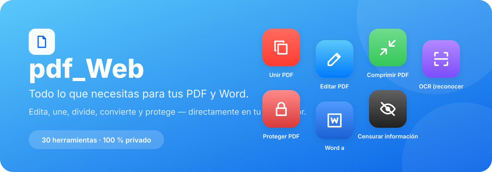
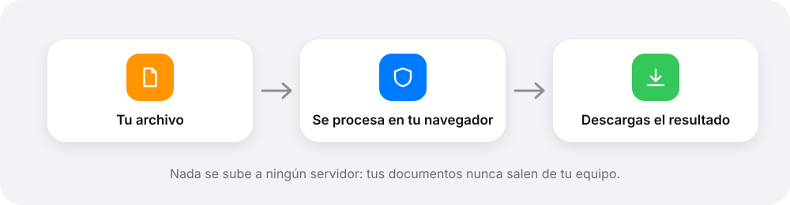
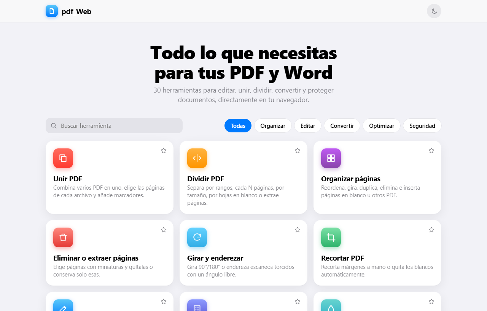
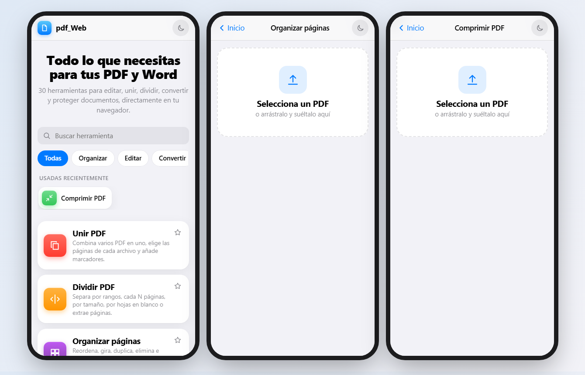
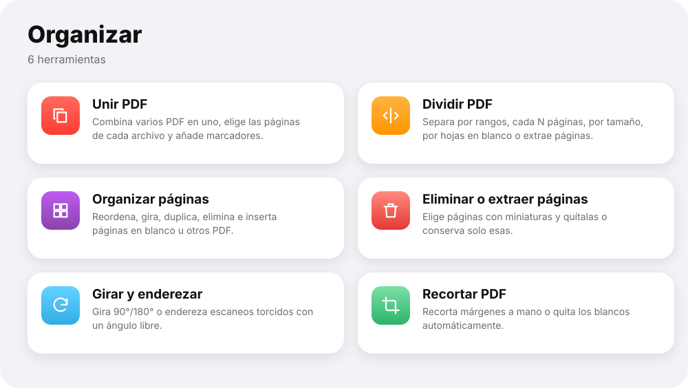
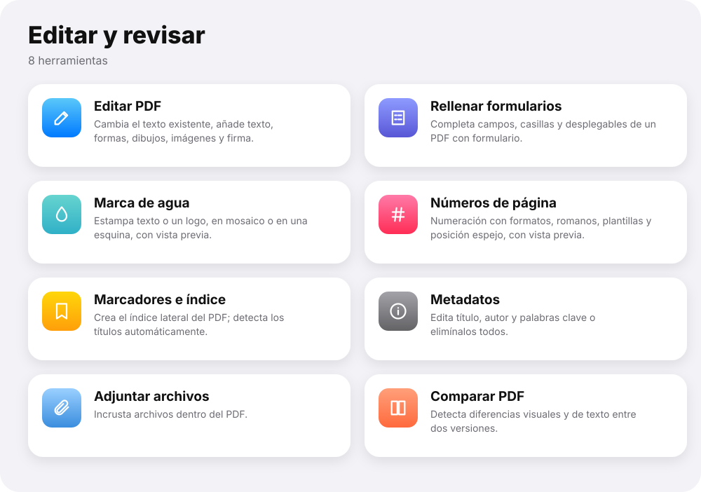
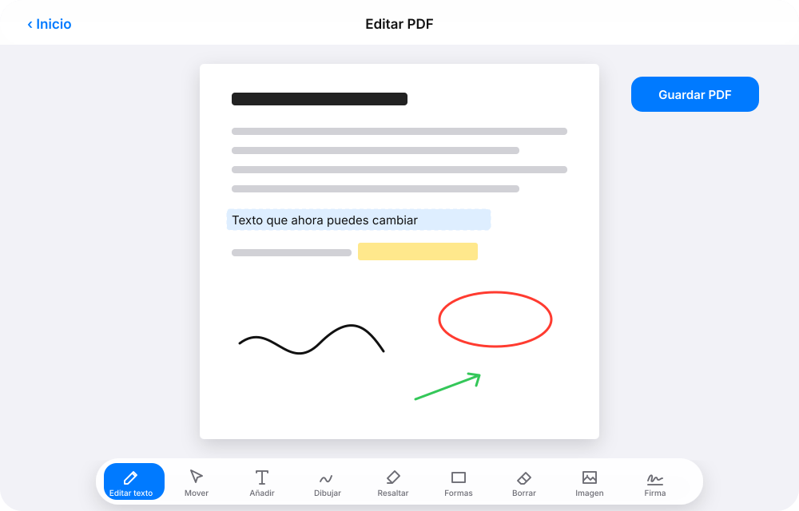
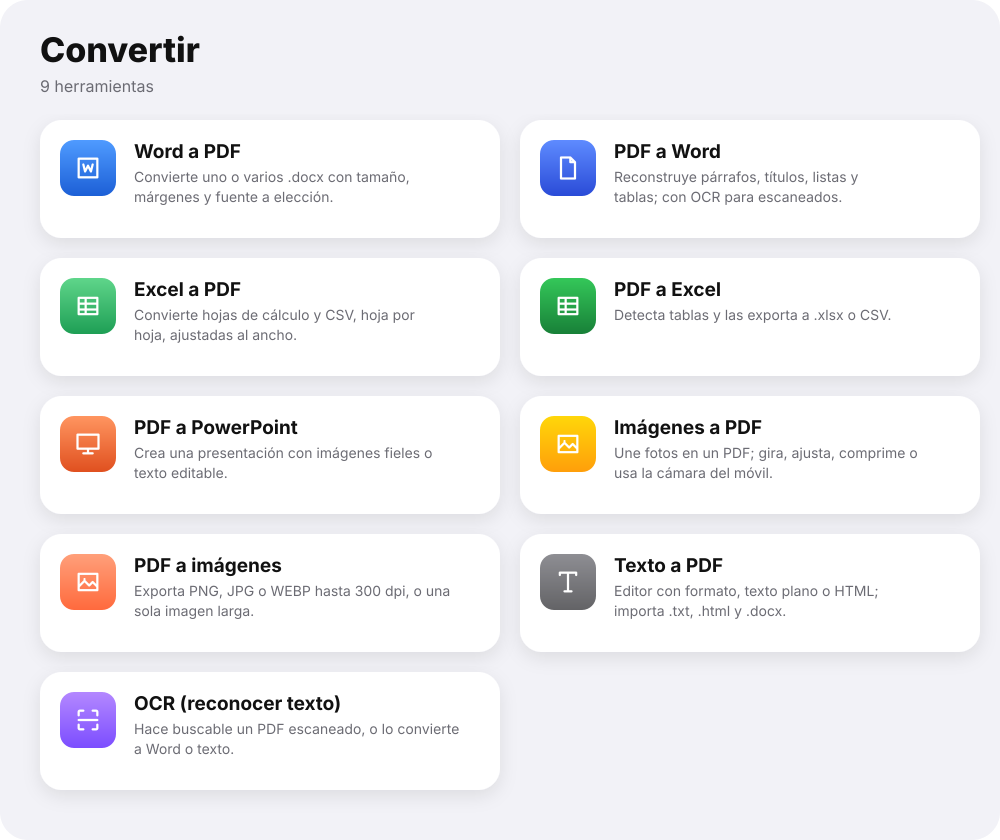
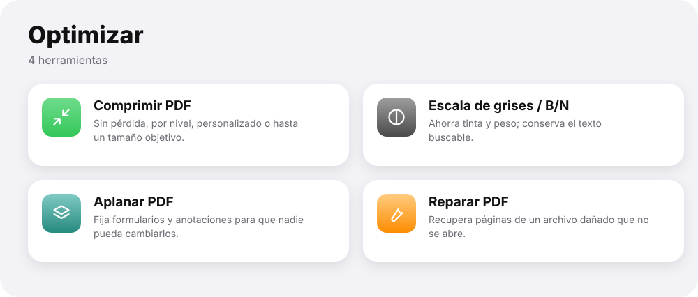
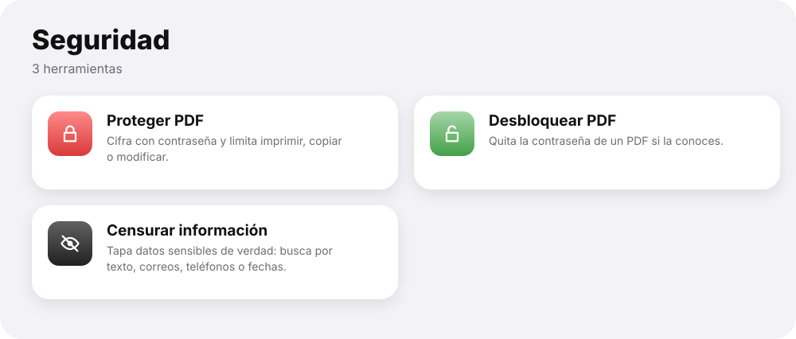

<p align="center">
  
</p>

# pdf_Web

Aplicación web para trabajar con **PDF y Word**, al estilo iLovePDF, con diseño inspirado en iOS.
Edita, une, divide, convierte, optimiza y protege documentos **directamente en el navegador**: los archivos nunca se suben a ningún servidor.

<p align="center">
  
</p>

## Índice

- [Capturas](#capturas)
- [Inicio rápido](#inicio-rápido)
- [Herramientas](#herramientas-30)
  - [Organizar](#organizar) · [Editar y revisar](#editar-y-revisar) · [Convertir](#convertir) · [Optimizar](#optimizar) · [Seguridad](#seguridad)
- [Funciones generales](#funciones-generales)
- [Diseño y responsive](#diseño-y-responsive)
- [Stack](#stack)
- [Limitaciones conocidas](#limitaciones-conocidas)
- [Estructura del proyecto](#estructura-del-proyecto)

## Capturas

| Escritorio · claro | Escritorio · oscuro |
|---|---|
|  |  |

**Móvil** (375 px de ancho):



## Inicio rápido

```bash
npm install
npm run dev      # servidor de desarrollo
npm run build    # versión de producción (carpeta dist/)
npm run preview  # previsualizar la build
```

Para regenerar las ilustraciones de este README: `node scripts/gen-docs.mjs`.

---

## Herramientas (30)

### Organizar



| Herramienta | Qué hace y opciones |
|---|---|
| **Unir PDF** | Une varios PDF en uno. Reordenar arrastrando o con flechas · ordenar A-Z · invertir orden · **rango de páginas por archivo** (p. ej. `1-3, 5`) · miniaturas · quitar archivos · nombre del archivo final · **marcador por cada archivo** (índice automático). |
| **Dividir PDF** | Cinco modos: **por rangos** (un PDF por rango) · **cada N páginas** · **por tamaño máximo en MB** · **por hojas en blanco** (corta y descarta las hojas vacías) · **extraer páginas** eligiéndolas con miniaturas. Nombre base personalizable. Descarga un PDF suelto o un ZIP. |
| **Organizar páginas** | Cuadrícula de miniaturas: **reordenar arrastrando**, girar ±90°, **duplicar**, eliminar, **insertar página en blanco**, **insertar páginas de otro PDF**, invertir orden, selección múltiple con acciones en lote y **deshacer**. |
| **Eliminar o extraer páginas** | Selecciona con miniaturas, rangos (`1-3, 7`), pares, impares o invertir; elimina las elegidas o conserva solo esas. |
| **Girar y enderezar** | Giro de 90°/180°/270° o **ángulo libre** (−45° a 45°) para enderezar escaneos torcidos, con opción de mantener o ampliar el tamaño de página. Aplica a todas, impares, pares o un rango. Vista previa animada. |
| **Recortar PDF** | **Manual** (márgenes arriba/abajo/izquierda/derecha, enlazados o por separado, con vista previa sobre la página) o **automático** (detecta y quita los blancos, con margen configurable y recorte uniforme). Aplica a todas, impares, pares o un rango; respeta páginas giradas. |

### Editar y revisar



#### Editar PDF

<p align="center"></p>

| Función | Detalle |
|---|---|
| **Editar texto existente** | Toca cualquier línea del documento y cámbiala por otra (o bórrala). Detecta el color, el tamaño y si es negrita, cursiva, serif o monoespaciada. |
| **Añadir texto** | Con fuente (Sans/Serif/Mono), negrita, cursiva, tamaño y color. |
| **Fecha** | Inserta la fecha de hoy con un toque. |
| **Dibujar** | Trazo libre con grosor y color. |
| **Resaltar · Subrayar · Tachar** | Resalta arrastrando; subraya o tacha tocando una línea de texto. |
| **Formas** | Rectángulo, elipse, línea y flecha. |
| **Borrar zona** | Tapa contenido con un recuadro opaco. |
| **Imágenes** | Inserta logos o fotos y cambia su tamaño con los tiradores. |
| **Firma** | Dibuja tu firma; se **guarda en el navegador** para reutilizarla. |
| **Edición de elementos** | Mover, redimensionar con tiradores, duplicar, eliminar, cambiar color/tamaño/fuente, **mover con las flechas del teclado** (Shift = 10 pt) y doble toque para editar el texto. |
| **Vista** | Zoom (60 %–220 %), navegación por páginas, **deshacer**. |

| Herramienta | Qué hace y opciones |
|---|---|
| **Rellenar formularios** | Detecta los campos del PDF y los lista por página: texto (también multilínea), casillas, desplegables, botones de opción y listas. Opción de **aplanar** al guardar y de vaciar todos los campos. |
| **Marca de agua** | **Texto o imagen/logo**. Fuente, negrita, cursiva, tamaño, color, opacidad, rotación (−90° a 90°). Posición: centro, **mosaico** (con separación), o cualquier esquina/centro superior e inferior (con margen). Aplica a todas, impares, pares o rango; opción de omitir la primera. **Vista previa en vivo**. |
| **Números de página** | Texto con plantillas y variables `{n}`, `{total}`, `{archivo}`, `{fecha}` · estilo **arábigo, romano (I/i) o letras (A/a)** · relleno con ceros · 6 posiciones · **alternar en páginas pares** (doble cara) · fuente, negrita, tamaño, color y margen · número inicial · empezar a numerar en la página N · alcance por rango. **Vista previa en vivo**. |
| **Marcadores e índice** | Crea el índice lateral del PDF: añadir/quitar marcadores, página destino, **niveles anidados**, **detección automática de títulos** por tamaño de letra. |
| **Metadatos** | Edita título, autor, asunto, palabras clave, creador y productor; muestra fechas; actualiza la fecha de modificación; **elimina todos los metadatos** (incluido XMP). |
| **Adjuntar archivos** | Incrusta cualquier archivo dentro del PDF. |
| **Comparar PDF** | **Visual**: tres vistas (original, modificado y diferencias en rojo) con control de sensibilidad, porcentaje de cambio, navegación por páginas y descarga de la imagen de diferencias. **Texto**: diferencia línea a línea con añadidos y eliminados. |

### Convertir



| Herramienta | Qué hace y opciones |
|---|---|
| **Word a PDF** | Uno o varios `.docx` a la vez (ZIP o un solo PDF unido). Tamaño A4/Carta/Legal · orientación · márgenes · fuente base y tamaño de letra · **texto buscable y copiable**. Conserva títulos, párrafos, listas, tablas e imágenes. |
| **PDF a Word** | Reconstruye **párrafos, títulos, listas con viñetas y tablas**. Rango de páginas · conservar saltos de línea · **OCR** para páginas escaneadas (con idioma). |
| **Excel a PDF** | `.xlsx`, `.xls`, `.csv`, `.ods`. Elige hojas · orientación automática/vertical/horizontal · tamaño de página · tamaño de letra · cuadrícula · nombre de hoja. Las tablas anchas se reducen para caber. |
| **PDF a Excel** | Detecta columnas por la posición del texto. Salida **XLSX** (una hoja por página o una sola) o **CSV** · detectar números · solo filas con varias columnas · rango de páginas. |
| **PDF a PowerPoint** | **Imagen fiel** (calidad configurable) o **texto editable** (cuadros de texto posicionados). Texto en las notas del orador · rango de páginas. |
| **Imágenes a PDF** | JPG, PNG, WEBP… Reordenar, **girar cada imagen**, tamaño A4/Carta/Legal/«como la imagen» · orientación · margen · ajuste (completa/rellenar/estirar) · **compresión** · color de fondo · **hacer foto con la cámara** del móvil. |
| **PDF a imágenes** | **PNG, JPG o WEBP** · 72/150/220/300 dpi · calidad · todas las páginas o un rango · **una imagen por página o una imagen larga** · nombre personalizado. Descarga en ZIP. |
| **Texto a PDF** | **Editor con formato** (negrita, cursiva, subrayado, títulos, listas, alineación), texto plano o HTML. **Importa** `.txt`, `.md`, `.html` y `.docx`. Tamaño de página, orientación, márgenes, fuente, tamaño, interlineado y texto buscable. |
| **OCR** | Reconoce texto de PDF escaneados en **7 idiomas** (español, inglés, francés, portugués, alemán, italiano…). Salida: **PDF con texto buscable**, **Word** o **texto**. Calidad de lectura, rango de páginas, confianza media y **cancelar**. |

### Optimizar



| Herramienta | Qué hace y opciones |
|---|---|
| **Comprimir PDF** | Cuatro modos: **sin pérdida** (reorganiza la estructura), **por nivel** (máxima/recomendada/alta), **personalizado** (resolución y calidad) y **tamaño objetivo en MB**. Opciones: conservar texto seleccionable y pasar a escala de grises. Muestra el ahorro. |
| **Escala de grises / B/N** | Escala de grises o blanco y negro con **umbral** ajustable · calidad · conservar texto buscable · todas las páginas o un rango (el resto queda intacto). |
| **Aplanar PDF** | **Solo formularios** (texto y vectores intactos) o **todo a imagen** (fusiona anotaciones, comentarios y sellos), con texto buscable opcional. |
| **Reparar PDF** | Reconstruye la estructura página a página y, si no basta, **redibuja las páginas como imágenes**. Informa de cuántas páginas se recuperaron. |

### Seguridad



| Herramienta | Qué hace y opciones |
|---|---|
| **Proteger PDF** | **Contraseña** con confirmación e indicador de fuerza · contraseña de propietario opcional · permisos: imprimir, copiar, anotar/rellenar, modificar/ensamblar. Verifica que el resultado realmente pide contraseña. |
| **Desbloquear PDF** | Quita la protección si conoces la contraseña (también elimina restricciones de permisos). |
| **Censurar información** | Marca áreas arrastrando o **busca texto, correos, teléfonos, fechas, números largos o enlaces** en todo el documento. Color del recuadro (negro/blanco/gris) y calidad. Las páginas censuradas se convierten en imagen, de modo que **el contenido tapado se elimina de verdad**. |

---

## Funciones generales

- **100 % en el navegador**: sin servidor, sin subir archivos.
- **Favoritas y recientes**: marca herramientas con la estrella; la portada muestra las últimas usadas.
- **Buscador y categorías** en la portada.
- **Modo claro y oscuro**: sigue el sistema y se puede cambiar manualmente (sin parpadeo al cargar).
- **Arrastrar y soltar** archivos en todas las herramientas, con validación del tipo de archivo.
- **Barras de progreso** y **cancelación** en procesos largos (OCR, compresión, conversiones).
- **Funciona sin conexión (PWA)** una vez visitada; se puede instalar como aplicación.
- **Descargas inteligentes**: PDF suelto o ZIP según el número de archivos.
- **Seguridad del HTML**: el HTML importado se limpia de scripts y manejadores de eventos.

## Diseño y responsive

Interfaz inspirada en iOS: tipografía del sistema, tarjetas redondeadas, controles segmentados con animación, hojas modales inferiores, barras de vidrio esmerilado y animaciones suaves (con respeto a `prefers-reduced-motion`).

Revisado en anchos desde **320 px** hasta **1280 px** (portada y pantalla inicial de las herramientas, con navegador real):

| Ancho | Comportamiento |
|---|---|
| ≤ 640 px (móvil) | Una columna de tarjetas con icono a la izquierda · categorías con desplazamiento horizontal · campos que pasan a varias líneas · barra de acción a todo el ancho · hojas modales desde abajo |
| 640–1100 px | Cuadrícula adaptable de tarjetas · editor con barra de herramientas flotante desplazable |
| ≥ 1100 px | Cuadrícula de tarjetas más ancha |

Además: áreas táctiles ampliadas en pantallas táctiles, márgenes seguros (`env(safe-area-inset-*)`) para móviles con muesca.

## Stack

React 18 + Vite · `pdf-lib` · `@cantoo/pdf-lib` (cifrado) · `pdfjs-dist` · `tesseract.js` (OCR) · `mammoth` · `docx` · `xlsx` · `pptxgenjs` · `html2canvas` · `jszip`

## Limitaciones conocidas

- **OCR**: la primera vez de cada idioma descarga el modelo (hace falta conexión).
- **Comprimir / Escala de grises / Aplanar a imagen / Censurar** rasterizan las páginas; el texto se conserva como capa invisible (opcional), pero se pierde el texto vectorial original.
- **Word / Excel / Texto → PDF** generan páginas como imagen con capa de texto invisible (buscable y copiable); no son PDF vectoriales.
- **PDF → Word / Excel / PowerPoint** reconstruyen a partir de la posición del texto: no conservan el diseño exacto, imágenes ni colores.
- **Editar texto existente**: se tapa el original con un parche del color del fondo y se escribe el nuevo con una fuente estándar parecida. El texto antiguo sigue en el archivo debajo del parche; para borrar información de verdad usa **Censurar**.
- **Permisos** (imprimir, copiar…) los respetan la mayoría de lectores, pero solo la contraseña impide abrir el archivo.
- **No incluye**: PowerPoint → PDF, PDF/A, URL → PDF (los navegadores bloquean la descarga de otras webs) ni interfaz en otros idiomas.

## Estructura del proyecto

```
src/
  App.jsx            shell, rutas por hash, portada, favoritas y recientes
  index.css          sistema de diseño (tokens iOS, modo oscuro, animaciones, responsive)
  components/        UI compartida (ui.jsx), PdfGate (selector de archivo, páginas, visor), miniaturas
  lib/               pdf.js (utilidades), runs.js (texto/tablas), rasterize.js, html.js, word.js,
                     ocr.js, outline.js, fonts.js, hooks.js
  tools/             una pantalla por herramienta (carga diferida) + registro en index.js
public/              favicon, manifest.webmanifest, sw.js
docs/img/            ilustraciones del README
scripts/gen-docs.mjs genera las ilustraciones SVG a partir del registro de herramientas
```
